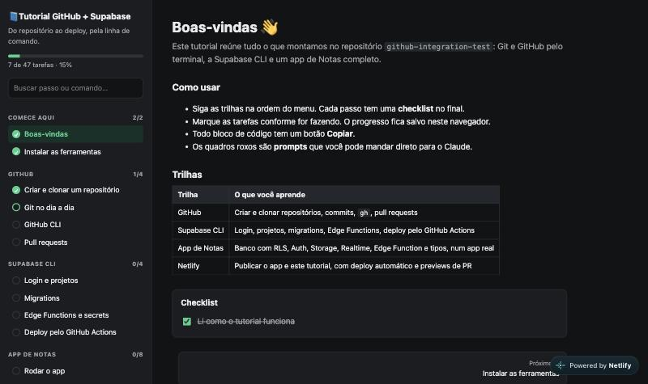
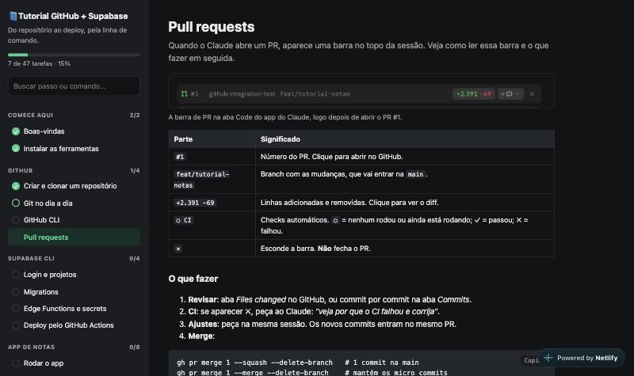
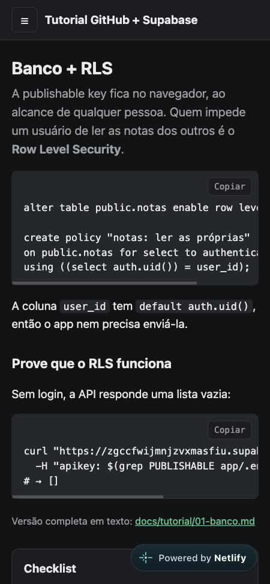
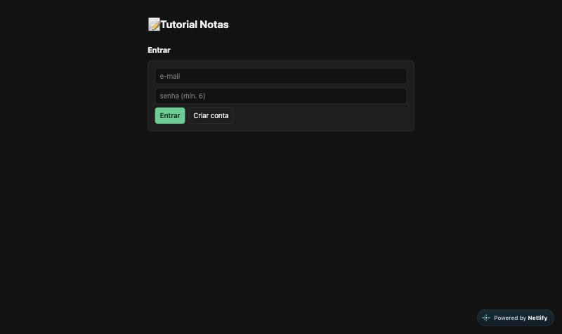

# github-integration-test

Repositório de referência pessoal para trabalhar com **Git/GitHub**, **Supabase** e **Netlify** pela linha de comando. Ele serve como guia de consulta, tem um tutorial prático com um app de exemplo e funciona como projeto de teste das integrações.

## 🌐 No ar

| | Link |
|---|---|
| Tutorial interativo | <https://tutorial-notas-ventura.netlify.app/tutorial/> |
| App de Notas | <https://tutorial-notas-ventura.netlify.app> |
| Painel do Netlify | <https://app.netlify.com/projects/tutorial-notas-ventura> |
| Painel da Supabase | <https://supabase.com/dashboard/project/zgccfwijmnjzvxmasfiu> |



## Comece aqui

```bash
./scripts/check-tools.sh   # o que está instalado e autenticado
./scripts/projeto.sh       # escolhe ou cria o projeto Supabase e vincula a este repo
```

| Ferramenta     | Instalação                              | Login              |
|----------------|-----------------------------------------|--------------------|
| Git            | `xcode-select --install`                | —                  |
| GitHub CLI     | `brew install gh`                       | `gh auth login`    |
| Supabase CLI   | `brew install supabase/tap/supabase`    | `supabase login`   |
| Netlify CLI    | `npm install -g --prefix ~/.local netlify-cli` | `netlify login` |
| Docker         | Docker Desktop ou OrbStack              | — (só para rodar a Supabase local) |

## Tutorial interativo

Versão em HTML de todo este repositório, com trilhas (GitHub, Supabase CLI, App de Notas, Netlify), checklist de progresso e botão de copiar nos comandos. Publicada em <https://tutorial-notas-ventura.netlify.app/tutorial/>.

| Passo "Pull requests" | No celular |
|---|---|
|  |  |

Para rodar localmente:

```bash
cd app && npm install && npm run dev
# abra http://localhost:5173/tutorial/index.html
```

Arquivo: [`app/public/tutorial/index.html`](app/public/tutorial/index.html). O progresso fica salvo no navegador.

## Tutorial: app de Notas

App em Vite + supabase-js que usa, módulo a módulo, as principais funcionalidades da Supabase. Veja o [índice do tutorial](docs/tutorial/README.md). Publicado em <https://tutorial-notas-ventura.netlify.app>.



| # | Módulo |
|---|---|
| 0 | [Escolher ou criar o projeto](docs/tutorial/00-projeto.md) |
| 1 | [Banco + migrations + RLS](docs/tutorial/01-banco.md) |
| 2 | [Interface web](docs/tutorial/02-interface.md) |
| 3 | [Auth](docs/tutorial/03-auth.md) |
| 4 | [Storage](docs/tutorial/04-storage.md) |
| 5 | [Realtime](docs/tutorial/05-realtime.md) |
| 6 | [Edge Function](docs/tutorial/06-edge-function.md) |
| 7 | [Tipos + CI](docs/tutorial/07-tipos-e-ci.md) |

```bash
cd app && npm install && npm run dev   # http://localhost:5173
```

## Guias de referência

### GitHub
0. [Criar um repositório novo e clonar](docs/github/00-novo-repositorio.md): pelo Claude, pelo `gh` ou pelo site
1. [Git básico](docs/github/01-git-basico.md): commits, branches, desfazer mudanças
2. [GitHub CLI](docs/github/02-github-cli.md): repositórios, PRs, Actions e secrets pelo terminal
3. [Pull requests](docs/github/03-pull-requests.md): a barra de PR do Claude, revisão, CI e merge

### Supabase CLI
1. [Instalação e login](docs/supabase/01-instalacao-e-login.md)
2. [Projetos e vínculo com o repositório](docs/supabase/02-projetos-e-link.md)
3. [Banco e migrations](docs/supabase/03-banco-e-migrations.md)
4. [Edge Functions, secrets e tipos](docs/supabase/04-edge-functions-secrets-tipos.md)
5. [Supabase + GitHub Actions](docs/supabase/05-github-actions.md)

### Netlify
1. [CLI e deploy](docs/netlify/01-cli-e-deploy.md): login, `netlify.toml`, variáveis, rascunho x produção
2. [Netlify + GitHub Actions](docs/netlify/02-github-actions.md): produção a cada merge e preview em cada PR

## Estrutura

```
.
├── app/                    # app de Notas (Vite + supabase-js)
│   └── public/tutorial/    # tutorial interativo em HTML
├── docs/
│   ├── github/             # guias de Git e GitHub CLI
│   ├── supabase/           # referência da Supabase CLI
│   ├── netlify/            # guias da Netlify CLI e deploy
│   ├── img/                # prints usados no README
│   └── tutorial/           # tutorial passo a passo do app
├── scripts/
│   ├── check-tools.sh      # verifica ferramentas e logins
│   └── projeto.sh          # escolhe/cria o projeto Supabase e vincula
├── supabase/
│   ├── config.toml         # configuração do projeto
│   ├── migrations/         # SQL versionado (tabela notas, bucket anexos)
│   └── functions/          # Edge Functions (exportar-notas)
├── .github/workflows/      # deploy automático (Supabase e Netlify)
├── netlify.toml            # build do site no Netlify
└── .env.example            # variáveis necessárias (copie para .env)
```

## Cola rápida

```bash
# GitHub
gh repo create meu-projeto --private --add-readme --clone
gh pr create --fill && gh pr checks

# Supabase
supabase projects list
supabase link --project-ref <ref>
supabase migration new <nome>
supabase db push
supabase functions deploy <nome> --use-api
supabase gen types typescript --linked > app/src/database.types.ts

# Netlify
netlify status
netlify build
netlify deploy --dir app/dist          # rascunho
netlify deploy --dir app/dist --prod   # produção
```
